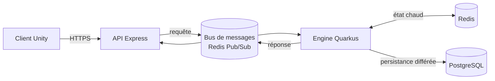

# Treasure Inc. — Engine

Moteur de jeu côté serveur de **Treasure Inc.**, un jeu mobile (Android, Unity) de chasse au trésor et de gestion d'inventaire.
Ce dépôt est la réécriture (« rebirth ») du moteur d'origine en **Java 21 / Quarkus**, avec une architecture réactive orientée messages.

> Le moteur n'est pas exposé publiquement : il ne reçoit des requêtes qu'à travers un bus de messages interne, alimenté par l'API du jeu.

---

## Vue d'ensemble du projet

Treasure Inc. est découpé en plusieurs dépôts :

| Composant | Rôle | Stack |
|---|---|---|
| Client mobile | Le jeu | Unity (C#), Android |
| Landing page | Site vitrine | Next.js |
| API | Point d'entrée des clients, authentification, relais vers le moteur | Node.js / Express |
| **Engine** (ce dépôt) | Logique métier : joueurs, objets, économie | Java 21, Quarkus |
| Maestro | Outillage d'administration et d'exploitation | Java, Quarkus |



## Architecture du moteur

### Communication par messages
L'API et le moteur ne se parlent pas en HTTP mais via un **canal de requêtes / réponses asynchrone** (pattern *request-reply* avec identifiant de corrélation).
Cela découple les deux services, permet de redémarrer ou de multiplier les instances du moteur sans impacter l'API, et garde le moteur hors de toute surface réseau publique.

Côté moteur, la chaîne de traitement est :

1. **Adaptateur de transport** — s'abonne au canal, gère la reconnexion automatique et isole les trames inattendues.
2. **Dispatcher** — indépendant du transport : il valide l'enveloppe, route vers le bon handler et construit la réponse.
3. **Handlers** — un bean CDI par type de requête. Ajouter une fonctionnalité revient à ajouter un handler, sans toucher au reste.

Types de requête (`payload.type`) et paramètres (`payload.params`) :

| Type | Paramètres | Réponse (`payload`) |
|---|---|---|
| `createUser` | — | 201 `{user}` (clé privée renvoyée une seule fois) |
| `login` | `user`, `private_key` | 200 `{user}` · 401 |
| `getItems` | `user`, `page` (dès 1), `limit` (≤ 100) | 200 `{items, page, limit, total}` · 404 |
| `getPrivateItems` | idem + `private_key` | idem · 401 |
| `generateItemsForUser` | `user`, `private_key`, `nb` (≤ 100) | 200 `{items}` · 401 |
| `sellItems` | `user`, `private_key`, `items: [{id}]` | 200 `{totalPrice, money}` · 401 · 404 |
| `startExpedition` | `user`, `private_key`, `cost` (≥ 1) | 200 `{money}` · 401 · 402 `{money}` |
| `healthcheck` | — | `{name, status, data, checks: [{name, status}]}` (checks de readiness : base, Redis) |

Un paramètre manquant ou invalide renvoie 400.

### Cache « write-behind »
L'état chaud des sessions de jeu (solde, inventaire) vit dans **Redis** pour des temps de réponse très faibles.
Un **job planifié** (Quarkus Scheduler) écrit périodiquement en base les sessions modifiées, puis évince les sessions inactives.
Le compromis est assumé : peu d'écritures en base pendant le jeu, et une fenêtre de resynchronisation bornée et configurable.

### Cohérence et concurrence
- **Verrou distribué par joueur** sur Redis (acquisition atomique, libération réservée au propriétaire, expiration de sécurité) : les actions d'un même joueur sont sérialisées, même avec plusieurs instances du moteur.
- La synchronisation travaille toujours sur une copie fraîche de la session, sous verrou, et sait réconcilier les objets créés ou vendus pendant l'écriture.
- Parcours incrémental du cache (jamais tout chargé en mémoire).

### Stack réactive
Tout le moteur est **non bloquant** : Mutiny, Vert.x, Hibernate Reactive Panache et client PostgreSQL réactif.
Les accès aux données sont derrière des interfaces (cache, dépôt, verrou), ce qui rend les services testables sans infrastructure.

### Génération procédurale
Les objets trouvés en expédition sont générés à partir de catalogues de textes et d'une table de rareté pondérée, avec gestion de l'accord grammatical (genre, articles) en français.

### Observabilité
- Logs structurés `clé=valeur` (lisibles et exploitables dans Kibana), JSON en production, **masquage automatique** des champs sensibles et troncature des charges volumineuses.
- Métriques **Prometheus** (Micrometer) et sondes de santé **SmallRye Health**.

## Organisation du code

```
src/main/java/.../engine
├── messaging   transport, dispatcher, contrat des handlers, format des réponses
├── user        joueurs : service, cache, verrou, persistance, handlers
├── item        objets : génération, cache, persistance, handlers
└── sync        synchronisation planifiée cache → base de données
```

Le code est organisé **par domaine métier** plutôt que par couche technique, chaque domaine exposant ses ports (interfaces) et ses adaptateurs Redis / PostgreSQL.

## Qualité

- Tests unitaires du dispatcher et des handlers (JUnit, Quarkus test).
- Configuration externalisée (YAML + profils), aucun réglage métier en dur.
- Images Docker JVM et **natives (GraalVM)** pour des démarrages rapides et une empreinte mémoire réduite.

## Lancer le projet en local

Prérequis : JDK 21, une instance PostgreSQL et une instance Redis.
Les paramètres de connexion se fournissent par variables d'environnement (convention Quarkus, par ex. `QUARKUS_DATASOURCE_USERNAME`, `QUARKUS_REDIS_HOSTS`…), jamais dans le dépôt.

```shell
./mvnw quarkus:dev          # mode développement avec rechargement à chaud
./mvnw test                 # tests
./mvnw package              # build JVM
./mvnw package -Dnative     # build natif (GraalVM ou build en conteneur)
```

## Auteur

Arnaud Boidard — conception et développement de l'ensemble du projet Treasure Inc.
