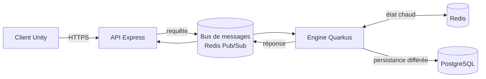

# Treasure Inc. — Engine

Moteur de jeu côté serveur de **Treasure Inc.**, un jeu mobile (Android, Unity) de chasse au trésor et de gestion d'inventaire.
Ce dépôt est la réécriture (« rebirth ») du moteur d'origine en **Java 21 / Quarkus**, avec une architecture réactive orientée messages.

> Le moteur n'est pas exposé publiquement : il ne reçoit des requêtes qu'à travers un bus de messages interne, alimenté par l'API du jeu.

---

## Vue d'ensemble du projet

Treasure Inc. est découpé en plusieurs dépôts :

| Composant | Rôle | Stack |
|---|---|---|
| Client mobile | Le jeu | Unity (C#), Android |
| Landing page | Site vitrine | Next.js |
| API | Point d'entrée des clients, authentification, relais vers le moteur | Node.js / Express |
| **Engine** (ce dépôt) | Logique métier : joueurs, objets, économie | Java 21, Quarkus |
| Maestro | Outillage d'administration et d'exploitation | Java, Quarkus |



## Architecture du moteur

### Communication par messages
L'API et le moteur ne se parlent pas en HTTP mais via un **canal de requêtes / réponses asynchrone** (pattern *request-reply* avec identifiant de corrélation).
Cela découple les deux services, permet de redémarrer ou de multiplier les instances du moteur sans impacter l'API, et garde le moteur hors de toute surface réseau publique.

Côté moteur, la chaîne de traitement est :

1. **Adaptateur de transport** — s'abonne au canal, gère la reconnexion automatique et isole les trames inattendues.
2. **Dispatcher** — indépendant du transport : il valide l'enveloppe, route vers le bon handler et construit la réponse.
3. **Handlers** — un bean CDI par type de requête. Ajouter une fonctionnalité revient à ajouter un handler, sans toucher au reste.

Types de requête (`payload.type`) et paramètres (`payload.params`) :

| Type | Paramètres | Réponse (`payload`) |
|---|---|---|
| `createUser` | — | 201 `{user}` (clé privée renvoyée une seule fois) |
| `login` | `user`, `private_key` | 200 `{user}` · 401 |
| `getItems` | `user`, `page` (dès 1), `limit` (≤ 100) | 200 `{items, page, limit, total}` · 404 |
| `getPrivateItems` | idem + `private_key` | idem · 401 |
| `sellItems` | `user`, `private_key`, `items: [{id}]` | 200 `{totalPrice, money}` · 401 · 404 |
| `digCase` | `user`, `private_key`, `location`, `case_id`, `cost` (≥ 0) | 200 `{rarity, money}` · 401 · 402 `{money}` · 409 (plus aucun personnage disponible) |
| `startExpedition` | `user`, `private_key`, `location`, `difficulty`, `character`, `case_id` (optionnel) | 200 `{expeditionId, character, money, itemCount}` · 401 · 402 `{money}` · 404 (personnage non recruté) · 409 (personnage déjà en expédition) |
| `generateItemsForUser` | `user`, `private_key`, `expedition_id` | 200 `{items}` · 401 · 404 |
| `getCharacters` | `user`, `private_key` | 200 `{characters}` · 401 |
| `equipItem` | `user`, `private_key`, `character`, `slot`, `item` | 200 `{characters}` · 400 (mauvais slot) · 401 · 404 (objet absent ou personnage non recruté) · 409 (personnage en expédition) |
| `unequipItem` | `user`, `private_key`, `character`, `slot` | 200 `{characters}` · 401 · 404 · 409 |
| `getPortals` | — | 200 `{portals: [{id, name, cost, multi, rates, characters}]}` |
| `recruit` | `user`, `private_key`, `portal`, `count` (1 ou `multi`, 1 par défaut) | 200 `{draws, money, characters}` · 401 · 402 `{money}` · 404 (portail inconnu) |
| `healthcheck` | — | `{name, status, data, checks: [{name, status}]}` (checks de readiness : base, Redis) |

Un paramètre manquant ou invalide renvoie 400.

### Cache « write-behind »
L'état chaud des sessions de jeu (solde, inventaire, équipement des personnages) vit dans **Redis** pour des temps de réponse très faibles.
Un **job planifié** (Quarkus Scheduler) écrit périodiquement en base les sessions modifiées, puis évince les sessions inactives.
Le compromis est assumé : peu d'écritures en base pendant le jeu, et une fenêtre de resynchronisation bornée et configurable.

Un objet généré reçoit tout de suite son **id définitif**, pris dans la séquence PostgreSQL `items_id_seq` : il ne change pas quand l'objet est écrit en base, et le client peut le vendre avant comme après la synchronisation.
Pour ne pas solliciter la base à chaque génération, les ids sont réservés **par blocs** (`engine.items.id-block-size`, 100 par défaut) en un seul appel (`nextval` sur un `generate_series`) ; ceux qui ne servent pas tout de suite attendent dans une liste Redis partagée par toutes les instances.

### Cohérence et concurrence
- **Verrou distribué par joueur** sur Redis (acquisition atomique, libération réservée au propriétaire, expiration de sécurité) : les actions d'un même joueur sont sérialisées, même avec plusieurs instances du moteur.
- La synchronisation travaille toujours sur une copie fraîche de la session, sous verrou, et sait réconcilier les objets créés ou vendus pendant l'écriture.
- Parcours incrémental du cache (jamais tout chargé en mémoire).

### Stack réactive
Tout le moteur est **non bloquant** : Mutiny, Vert.x, Hibernate Reactive Panache et client PostgreSQL réactif.
Les accès aux données sont derrière des interfaces (cache, dépôt, verrou), ce qui rend les services testables sans infrastructure.

### Génération procédurale
Les objets trouvés en expédition sont générés à partir de catalogues de textes et d'une table de rareté pondérée, avec gestion de l'accord grammatical (genre, articles) en français.

### Expéditions
Les lieux et leur niveau se déclarent dans `engine.expeditions.locations` : ajouter un lieu revient à ajouter une ligne, plus l'asset correspondant dans le client.

- **Creusage d'une case** : le premier clic paie le coût envoyé par le client et tire une rareté de 0 à 4. Tant qu'aucune expédition n'est envoyée vers ce lieu, recreuser la case renvoie la même rareté gratuitement.
- **Envoi** : coût = `étages × 100 × niveau du lieu`. L'expédition est gardée dans Redis jusqu'à l'ouverture de son coffre.
- **Coffre** : il ne s'ouvre qu'une fois. Son nombre d'objets est fixé à l'envoi :

```
n = min(15, max(1, round(étages × (0,5 + 0,25 × niveau) × (1 + 0,25 × rareté))))
```

### Équipements et personnages

**Objets équipables.** Chaque objet généré a `engine.items.equipable-chance` % de chance (5 par défaut) d'être un équipement.
Ses caractéristiques tiennent dans un seul champ JSON, la colonne `items.stats` (`jsonb`, `NULL` pour un objet ordinaire) :

```json
{ "slot": 3, "for": 5, "luk": 2, "spe1": "breakable", "spe2": "luck_charm" }
```

| Clé | Sens |
|---|---|
| `slot` | numéro de l'emplacement où l'objet s'équipe (tableau ci-dessous) |
| `for`, `con`, `luk` | force, constitution et chance ajoutées au personnage |
| `spe1`, `spe2`… | identifiants de compétences définies dans le moteur (`Equipment.Skill`) |

Le client ne reçoit que l'identifiant d'une compétence : il affiche sa propre description.

| Compétence | Effet |
|---|---|
| `breakable` | l'objet peut casser — définie et affichée, mais rien ne casse encore un objet |
| `luck_charm` | à l'ouverture du coffre, chaque objet porté par le personnage de l'expédition a 25 % de chance d'ajouter un objet |

La force, la constitution et la chance sont stockées et affichées ; elles n'ont pas encore d'effet en jeu.

**Emplacements.** Les numéros sont stockés en base et connus du client : ils ne changent jamais.

| N° | Emplacement | Objets | Caractéristique |
|---|---|---|---|
| 1 | Tête | casques | constitution |
| 2 | Armure | armures | constitution |
| 3 | Arme | épées | force |
| 4 | Bouclier | boucliers | constitution |
| 5 | Bottes | bottes | constitution |
| 6 | Gants | gants | force |
| 7 | Anneau | anneaux | chance |
| 8 | Amulette | amulettes | chance |
| 9 | Talisman | talismans | chance |

Un équipement reçoit le nom et un des sprites de sa famille (`Equipment.Kind`). La valeur de sa caractéristique dépend de sa rareté :
commun 1-5, peu commun 4-10, rare 8-18, épique 15-30, légendaire 30-50.

**Personnages.** Les personnages du jeu sont définis dans le moteur (`CharacterCatalog`) : un numéro, un nom, un rang et
des caractéristiques propres. Chaque joueur commence avec les `engine.characters.count` premiers (3) et recrute les autres
(voir « Recrutement »). Ses personnages sont dans la table `characters` (`user_id`, `num`, `equipment`, `copies`) : `num` est le
numéro du personnage dans le catalogue, `copies` le nombre de fois où il a été obtenu.
La colonne `equipment` (`jsonb`) ne contient que l'id de l'objet par numéro d'emplacement :

```json
{ "2": 812, "3": 640 }
```

- Un objet équipé reste un objet du joueur, mais il quitte l'inventaire : `getItems` ne le renvoie plus et `sellItems` le refuse.
  Le retirer, ou équiper un autre objet au même emplacement, le remet dans l'inventaire.
- Comme pour le reste, toute modification est faite dans Redis (`treasure_inc.characters.<publicKey>`) sous le verrou du joueur ;
  la synchronisation l'écrit en base plus tard.
- `getCharacters`, `equipItem` et `unequipItem` répondent avec tous les personnages du joueur :
  `[{num, name, rank, stats: {for, con, luk}, copies, expeditionId, equipment: {"<slot>": {objet}}}]`.

**Personnages et expéditions.** Une expédition est menée par un personnage (`character`), indisponible jusqu'à l'ouverture de son coffre :
il ne peut ni mener une autre expédition ni changer d'équipement (409). Quand tous les personnages sont partis, plus rien ne peut être creusé ni envoyé.

### Recrutement

Les personnages s'invoquent par des **portails**, sans savoir à l'avance qui sortira. Il n'y en a qu'un pour l'instant,
`masterpack1` (« Masterpack vol. 1 »), qui contient les 20 personnages du catalogue.

Un tirage coûte `engine.recruitment.cost` (1000) ; `recruit` en fait 1 ou `engine.recruitment.multi` (10) d'un coup.
Chaque tirage choisit d'abord un **rang** selon la table ci-dessous, puis un personnage du portail au hasard parmi ceux de ce rang.

| Rang | SSS | SS | S | A | B | C | D |
|---|---|---|---|---|---|---|---|
| Chance | 0,1 % | 0,9 % | 3 % | 9 % | 17 % | 30 % | 40 % |
| Personnages du portail | 1 | 1 | 1 | 3 | 4 | 5 | 5 |

- Un personnage que le joueur n'a pas rejoint son équipe : il peut aussitôt être équipé et mener une expédition.
- Un personnage déjà possédé est un **doublon** : seul son compteur `copies` augmente (sans effet en jeu pour l'instant).
- `recruit` répond avec les tirages dans l'ordre, `draws: [{num, name, rank, stats, isNew, copies}]`, le nouveau solde et
  tous les personnages du joueur. Le client s'appuie sur les rangs tirés pour son animation.
- `getPortals` décrit les portails (prix, table des chances, personnages) : le client n'a aucune de ces valeurs en dur.
- Il n'y a pas de garantie (« pity ») : chaque tirage est indépendant.

Ajouter un personnage : une ligne dans `CharacterCatalog` (les numéros ne changent jamais) et son portrait dans le client.

Le schéma se met à jour avec `src/main/resources/db/update_001_equipment.sql` puis `update_002_recruitment.sql`.

### Observabilité
- Logs structurés `clé=valeur` (lisibles et exploitables dans Kibana), JSON en production, **masquage automatique** des champs sensibles et troncature des charges volumineuses.
- Métriques **Prometheus** (Micrometer) et sondes de santé **SmallRye Health**.

## Organisation du code

```
src/main/java/.../engine
├── messaging   transport, dispatcher, contrat des handlers, format des réponses
├── user        joueurs : service, cache, verrou, persistance, handlers
├── item        objets : génération, équipements, cache, persistance, handlers
├── character   personnages : catalogue, recrutement, équipement, cache, persistance, handlers
├── expedition  expéditions : creusage, envoi, coffres, règles, noms générés
└── sync        synchronisation planifiée cache → base de données
```

Le code est organisé **par domaine métier** plutôt que par couche technique, chaque domaine exposant ses ports (interfaces) et ses adaptateurs Redis / PostgreSQL.

## Qualité

- Tests unitaires du dispatcher et des handlers (JUnit, Quarkus test).
- Configuration externalisée (YAML + profils), aucun réglage métier en dur.
- Images Docker JVM et **natives (GraalVM)** pour des démarrages rapides et une empreinte mémoire réduite.

## Lancer le projet en local

Prérequis : JDK 21, une instance PostgreSQL et une instance Redis.
Les paramètres de connexion se fournissent par variables d'environnement (convention Quarkus, par ex. `QUARKUS_DATASOURCE_USERNAME`, `QUARKUS_REDIS_HOSTS`…), jamais dans le dépôt.

```shell
./mvnw quarkus:dev          # mode développement avec rechargement à chaud
./mvnw test                 # tests
./mvnw package              # build JVM
./mvnw package -Dnative     # build natif (GraalVM ou build en conteneur)
```

## Auteur

Arnaud Boidard — conception et développement de l'ensemble du projet Treasure Inc.
