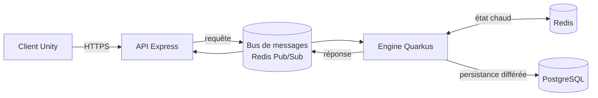

# Treasure Inc. — Engine

Moteur de jeu côté serveur de **Treasure Inc.**, un jeu mobile (Android, Unity) de chasse au trésor et de gestion d'inventaire.
Ce dépôt est la réécriture (« rebirth ») du moteur d'origine en **Java 21 / Quarkus**, avec une architecture réactive orientée messages.

> Le moteur n'est pas exposé publiquement : il ne reçoit des requêtes qu'à travers un bus de messages interne, alimenté par l'API du jeu.

---

## Vue d'ensemble du projet

Treasure Inc. est découpé en plusieurs dépôts :

| Composant | Rôle | Stack |
|---|---|---|
| Client mobile | Le jeu | Unity (C#), Android |
| Landing page | Site vitrine | Next.js |
| API | Point d'entrée des clients, authentification, relais vers le moteur | Node.js / Express |
| **Engine** (ce dépôt) | Logique métier : joueurs, objets, économie | Java 21, Quarkus |
| Maestro | Outillage d'administration et d'exploitation | Java, Quarkus |



## Architecture du moteur

### Communication par messages
L'API et le moteur ne se parlent pas en HTTP mais via un **canal de requêtes / réponses asynchrone** (pattern *request-reply* avec identifiant de corrélation).
Cela découple les deux services, permet de redémarrer ou de multiplier les instances du moteur sans impacter l'API, et garde le moteur hors de toute surface réseau publique.

Côté moteur, la chaîne de traitement est :

1. **Adaptateur de transport** — s'abonne au canal, gère la reconnexion automatique et isole les trames inattendues.
2. **Dispatcher** — indépendant du transport : il valide l'enveloppe, route vers le bon handler et construit la réponse.
3. **Handlers** — un bean CDI par type de requête. Ajouter une fonctionnalité revient à ajouter un handler, sans toucher au reste.

Types de requête (`payload.type`) et paramètres (`payload.params`) :

| Type | Paramètres | Réponse (`payload`) |
|---|---|---|
| `createUser` | — | 201 `{user}` (clé privée renvoyée une seule fois) |
| `login` | `user`, `private_key` | 200 `{user}` · 401 |
| `getItems` | `user`, `page` (dès 1), `limit` (≤ 100) | 200 `{items, page, limit, total}` · 404 |
| `getPrivateItems` | idem + `private_key` | idem · 401 |
| `sellItems` | `user`, `private_key`, `items: [{id}]` | 200 `{totalPrice, money}` · 401 · 404 |
| `digCase` | `user`, `private_key`, `location`, `case_id`, `cost` (≥ 0) | 200 `{rarity, money}` · 401 · 402 `{money}` · 409 (plus aucun personnage disponible) |
| `startExpedition` | `user`, `private_key`, `location`, `difficulty`, `character`, `case_id` (optionnel) | 200 `{expeditionId, character, money, itemCount, xp, run}` (voir « Obstacles et combats ») · 401 · 402 `{money}` · 404 (personnage non recruté) · 409 (personnage déjà en expédition) |
| `generateItemsForUser` | `user`, `private_key`, `expedition_id` | 200 `{items, xp, floors, floorsCompleted}` (voir « Niveaux et expérience ») · 401 · 404 |
| `getCharacters` | `user`, `private_key` | 200 `{characters}` · 401 |
| `equipItem` | `user`, `private_key`, `character`, `slot`, `item` | 200 `{characters}` · 400 (mauvais slot) · 401 · 404 (objet absent ou personnage non recruté) · 409 (personnage en expédition) |
| `unequipItem` | `user`, `private_key`, `character`, `slot` | 200 `{characters}` · 401 · 404 · 409 |
| `getPortals` | — | 200 `{portals: [{id, name, cost, multi, rates, characters}]}` |
| `recruit` | `user`, `private_key`, `portal`, `count` (1 ou `multi`, 1 par défaut) | 200 `{draws, money, characters}` · 401 · 402 `{money}` · 404 (portail inconnu) |
| `getQuests` | `user`, `private_key` | 200 `{claimable, daily, weekly}` (voir « Quêtes ») · 401 |
| `claimQuest` | `user`, `private_key`, `quest` | 200 `{quest, money, reward: {money, items}, quests}` · 401 · 404 (quête absente des tableaux du joueur) · 409 (quête non terminée ou déjà récupérée) |
| `healthcheck` | — | `{name, status, data, checks: [{name, status}]}` (checks de readiness : base, Redis) |

Un paramètre manquant ou invalide renvoie 400.

### Cache « write-behind »
L'état chaud des sessions de jeu (solde, inventaire, équipement des personnages) vit dans **Redis** pour des temps de réponse très faibles.
Un **job planifié** (Quarkus Scheduler) écrit périodiquement en base les sessions modifiées, puis évince les sessions inactives.
Le compromis est assumé : peu d'écritures en base pendant le jeu, et une fenêtre de resynchronisation bornée et configurable.

Un objet généré reçoit tout de suite son **id définitif**, pris dans la séquence PostgreSQL `items_id_seq` : il ne change pas quand l'objet est écrit en base, et le client peut le vendre avant comme après la synchronisation.
Pour ne pas solliciter la base à chaque génération, les ids sont réservés **par blocs** (`engine.items.id-block-size`, 100 par défaut) en un seul appel (`nextval` sur un `generate_series`) ; ceux qui ne servent pas tout de suite attendent dans une liste Redis partagée par toutes les instances.

### Cohérence et concurrence
- **Verrou distribué par joueur** sur Redis (acquisition atomique, libération réservée au propriétaire, expiration de sécurité) : les actions d'un même joueur sont sérialisées, même avec plusieurs instances du moteur.
- La synchronisation travaille toujours sur une copie fraîche de la session, sous verrou, et sait réconcilier les objets créés ou vendus pendant l'écriture.
- Parcours incrémental du cache (jamais tout chargé en mémoire).

### Stack réactive
Tout le moteur est **non bloquant** : Mutiny, Vert.x, Hibernate Reactive Panache et client PostgreSQL réactif.
Les accès aux données sont derrière des interfaces (cache, dépôt, verrou), ce qui rend les services testables sans infrastructure.

### Génération procédurale
Les objets trouvés en expédition sont générés à partir de catalogues de textes et d'une table de rareté pondérée, avec gestion de l'accord grammatical (genre, articles) en français.

### Expéditions
Les lieux et leur niveau se déclarent dans `engine.expeditions.locations` : ajouter un lieu revient à ajouter une ligne, plus l'asset correspondant dans le client.

- **Creusage d'une case** : le premier clic paie le coût envoyé par le client et tire une rareté de 0 à 4. Tant qu'aucune expédition n'est envoyée vers ce lieu, recreuser la case renvoie la même rareté gratuitement.
- **Envoi** : coût = `étages × 100 × niveau du lieu`. L'expédition est gardée dans Redis jusqu'à l'ouverture de son coffre.
- **Coffre** : il ne s'ouvre qu'une fois. Son nombre d'objets est fixé à l'envoi :

```
n = min(15, max(1, round(étages × (0,5 + 0,25 × niveau) × (1 + 0,25 × rareté))))
```

### Équipements et personnages

**Objets équipables.** Chaque objet généré a `engine.items.equipable-chance` % de chance (5 par défaut) d'être un équipement.
Ses caractéristiques tiennent dans un seul champ JSON, la colonne `items.stats` (`jsonb`, `NULL` pour un objet ordinaire) :

```json
{ "slot": 3, "for": 5, "luk": 2, "spe1": "finish_him", "spe2": "sharp" }
```

| Clé | Sens |
|---|---|
| `slot` | numéro de l'emplacement où l'objet s'équipe (tableau ci-dessous) |
| `for`, `con`, `agi`, `luk` | force, constitution, agilité et chance ajoutées au personnage |
| `spe1`, `spe2`… | identifiants de compétences définies dans le moteur (`Equipment.Skill`) |

Le client ne reçoit que l'identifiant d'une compétence : il affiche sa propre description.

| Compétence | Effet |
|---|---|
| `breakable` | l'objet peut casser — définie et affichée, mais rien ne casse encore un objet |
| `luck_charm` | à l'ouverture du coffre, chaque objet porté par le personnage de l'expédition a 25 % de chance d'ajouter un objet |

Les autres compétences servent en combat : voir « Obstacles et combats ». Un équipement porte une compétence d'autant
plus souvent qu'il est rare (commun 10 %, peu commun 20 %, rare 35 %, épique 60 %, légendaire 100 %), et une fois sur
cinq une seconde. Chaque compétence ne se trouve que sur les familles d'objets qui lui vont (`finish_him` sur une épée,
`ambush` sur des bottes…).

**Emplacements.** Les numéros sont stockés en base et connus du client : ils ne changent jamais.

| N° | Emplacement | Objets | Caractéristique |
|---|---|---|---|
| 1 | Tête | casques | constitution |
| 2 | Armure | armures | constitution |
| 3 | Arme | épées | force |
| 4 | Bouclier | boucliers | constitution |
| 5 | Bottes | bottes | agilité |
| 6 | Gants | gants | force |
| 7 | Anneau | anneaux | chance |
| 8 | Amulette | amulettes | chance |
| 9 | Talisman | talismans | chance |

Un équipement reçoit le nom et un des sprites de sa famille (`Equipment.Kind`) : ceux de la planche d'objets du client
(les 181 premiers identifiants) et 16 skins par famille que le client dessine lui-même (`ItemArt.cs`, identifiants
181 à 324, dans l'ordre des familles). `engine.items.graphics-count` (325) est le nombre total de sprites du client ;
un objet ordinaire ne reçoit qu'un sprite de la planche. La valeur de sa caractéristique dépend de sa rareté :
commun 1-5, peu commun 4-10, rare 8-18, épique 15-30, légendaire 30-50.

**Personnages.** Les personnages du jeu sont définis dans le moteur (`CharacterCatalog`) : un numéro, un nom, un rang et
des caractéristiques propres (force, constitution, agilité, chance). Les personnages de rang D et C n'ont aucune
compétence à eux ; un B en a 1, un A 2, un S 3, un SS 4 et un SSS 5. Chaque joueur commence avec les `engine.characters.count` premiers (3) et recrute les autres
(voir « Recrutement »). Ses personnages sont dans la table `characters` (`user_id`, `num`, `equipment`, `copies`, `xp`) : `num` est le
numéro du personnage dans le catalogue, `copies` le nombre de fois où il a été obtenu, `xp` l'expérience qu'il a gagnée.
La colonne `equipment` (`jsonb`) ne contient que l'id de l'objet par numéro d'emplacement :

```json
{ "2": 812, "3": 640 }
```

- Un objet équipé reste un objet du joueur, mais il quitte l'inventaire : `getItems` ne le renvoie plus et `sellItems` le refuse.
  Le retirer, ou équiper un autre objet au même emplacement, le remet dans l'inventaire.
- Comme pour le reste, toute modification est faite dans Redis (`treasure_inc.characters.<publicKey>`) sous le verrou du joueur ;
  la synchronisation l'écrit en base plus tard.
- `getCharacters`, `equipItem` et `unequipItem` répondent avec tous les personnages du joueur :
  `[{num, name, rank, stats: {for, con, agi, luk}, skills, combat, level, xp, xpNext, copies, expeditionId, equipment: {"<slot>": {objet}}}]`.
  `stats` sont les caractéristiques du personnage à son niveau, sans son équipement, et `skills` ses compétences
  propres. `combat` est ce qu'il vaut en combat, équipement compris : `{hp, attack, defense, interval, crit, dodge}`.

**Personnages et expéditions.** Une expédition est menée par un personnage (`character`), indisponible jusqu'à l'ouverture de son coffre :
il ne peut ni mener une autre expédition ni changer d'équipement (409). Quand tous les personnages sont partis, plus rien ne peut être creusé ni envoyé.

### Niveaux et expérience

Chaque personnage a un **niveau**, de 1 à 100, et gagne de l'**expérience** en menant des expéditions. Les règles sont dans `Leveling`.

- **Gain.** À l'ouverture du coffre, le personnage de l'expédition gagne
  `étages × engine.expeditions.xp-per-floor (10) × niveau du lieu × (1 + 0,25 × rareté)` points (arrondi à l'entier inférieur) :
  de 10 points pour un étage à Mordak à 600 pour dix étages à Bobafett sur une case légendaire. Le montant est fixé à l'envoi
  et renvoyé par `startExpedition` (`xp`).
- **Niveaux.** Passer du niveau `n` au suivant demande `100 × n` points : chaque niveau est plus long que le précédent
  (100 points pour le niveau 2, 9 900 pour le niveau 100, 495 000 en tout). Au niveau 100 un personnage ne gagne plus rien.
- **Caractéristiques.** Chaque niveau gagné donne des points de caractéristique, d'autant plus que le rang est élevé :
  1 pour un D, 2 pour un C, 3 pour un B, 4 pour un A, 5 pour un S, 6 pour un SS, 7 pour un SSS. Ils sont répartis un par un
  entre la force, la constitution, l'agilité et la chance, en proportion des caractéristiques d'origine du personnage : il garde son profil.
- **Stockage.** Seul le total des points gagnés est stocké (`characters.xp`, et `xp` dans Redis) : le niveau et les
  caractéristiques s'en déduisent.

`generateItemsForUser` renvoie, à côté des objets, ce que l'expédition a rapporté à son personnage
(`null` pour une expédition sans personnage) :

```json
"xp": { "character": 2, "gained": 150, "levelBefore": 1, "level": 2, "xp": 50, "xpNext": 200,
        "statsBefore": { "for": 2, "con": 3, "agi": 1, "luk": 1 }, "stats": { "for": 2, "con": 4, "agi": 1, "luk": 1 } }
```

`xp` est l'expérience acquise dans le niveau courant et `xpNext` ce que ce niveau demande (0 au niveau 100) ; ce sont les
mêmes champs que ceux d'un personnage. `gained` est ce qui a réellement été gagné (0 au niveau 100).

### Obstacles et combats

Le chemin d'un personnage dans une expédition est **entièrement décidé par le moteur à l'envoi** (`ExpeditionRun`) :
`startExpedition` le renvoie dans `run`, et le client le rejoue sans rien calculer.

**Obstacles.** Chaque étage a `engine.expeditions.obstacles.spots` (2) emplacements. Chacun a `barricade-chance` (15 %)
de chance de porter une barricade et `monster-chance` (15 %) de porter un monstre. Le coffre de fin d'étage a
`guardian-chance` (20 %) de chance d'être gardé par un **gardien** : un monstre plus fort (vie × 1,5, attaque × 1,2)
qui laisse le coffre en mourant.

- Une **barricade** ne fait que bloquer le personnage le temps qu'il la détruise :
  `solidité × intervalle d'attaque / attaque`, entre 1 et 20 secondes. Solidité : 25 × l'échelle de l'étage.
- Un **monstre** se combat. Il y en a dix (`Monster.KINDS`, du rat des mines au golem de pierre), chacun avec son profil.
  L'échelle de l'étage vaut `échelle du lieu × (1 + 0,12 × (étage − 1))` : un monstre moyen a
  `26 × échelle` points de vie et `2 + 4 × échelle` d'attaque.
  L'échelle du lieu (`Monster.LEVEL_SCALE`) dépend de son niveau : × 1 au niveau 1, × 8 au niveau 2, × 60 au niveau 3.
  Le niveau 1 se fait avec un débutant ; le niveau 2 demande un personnage qui a pris des niveaux et porte un peu
  d'équipement (un rang B niveau 20 en équipement peu commun finit 10 étages environ 2 fois sur 3) ; le niveau 3
  demande un haut niveau et un bon équipement (un rang SS niveau 70 en équipement épique finit 10 étages 9 fois sur 10,
  un rang S niveau 50 en épique environ 1 fois sur 7).

**Le personnage en combat** (`Fighter`), équipement compris :

| Valeur | Formule |
|---|---|
| Points de vie | 60 + 8 × constitution |
| Attaque | 6 + 2 × force |
| Défense | constitution — un coup reçu fait `attaque × 100 / (100 + 3 × défense)`, au moins 1 |
| Vitesse | une attaque toutes les `2000 / (1 + 0,05 × agilité)` ms, 400 ms au plus vite |
| Critique | 5 % + 1 point pour 2 de chance, 50 % au plus ; un coup critique fait 150 % des dégâts |

**Combat** (`Combat`). Il est automatique : chacun frappe à son rythme jusqu'à la mort de l'un des deux (un combat de
plus de 2 minutes est perdu). Le personnage **garde ses blessures** d'un combat au suivant. Si ses points de vie tombent
à zéro, l'**expédition s'arrête** : il ne rapporte que la part des étages terminés
(`objets × étages terminés / étages`, de même pour l'expérience) — rien du tout s'il meurt au premier étage.

**Compétences.** Un personnage a les siennes et celles de son équipement ; une même compétence ne compte qu'une fois.

| Active (utilisée en combat selon les circonstances) | Effet |
|---|---|
| `finish_him` | l'ennemi a moins de 10 % de ses points de vie : attaque critique à 2× dégâts (1 fois par combat) |
| `engagement` | au début du combat : défense +50 % pendant 5 s |
| `second_wind` | à 30 % de vie ou moins : récupère 25 % de sa vie (1 fois par combat) |
| `berserk` | à 50 % de vie ou moins : attaque 50 % plus vite pendant 6 s (1 fois par combat) |
| `riposte` | après un coup reçu : 25 % de chance de frapper aussitôt |
| `shield_bash` | après 3 s puis toutes les 8 s : étourdit l'ennemi 1,5 s |
| `double_strike` | une attaque sur quatre frappe deux fois |
| `ambush` | au début du combat : une attaque à 150 % de dégâts |
| `poison` | toutes les 10 s, une attaque empoisonne : 30 % de l'attaque par seconde pendant 5 s |
| `last_stand` | le premier coup fatal de l'expédition laisse 1 point de vie, puis rien ne blesse pendant 2 s |
| `war_cry` | au début du combat : attaque de l'ennemi −25 % pendant 6 s |
| `drain` | toutes les 6 s, s'il est blessé : une attaque qui rend en vie les dégâts infligés |

| Passive (toute la durée de l'expédition) | Effet |
|---|---|
| `tough` | points de vie +20 % |
| `sharp` | attaque +15 % |
| `swift` | vitesse d'attaque +20 % |
| `thick_skin` | défense +25 % |
| `keen_eye` | chance de critique +15 points |
| `demolisher` | barricades détruites 2× plus vite |
| `regeneration` | récupère 10 % de sa vie à la fin de chaque étage |
| `thorns` | renvoie 20 % des dégâts reçus |
| `looter` | chaque monstre vaincu a 20 % de chance d'ajouter un objet au coffre |
| `dodge` | 15 % de chance d'esquiver une attaque |

**Format de `run`.** Les étages s'arrêtent à celui où le personnage est mort.

```json
"run": { "maxHp": 84, "floorsCompleted": 1, "dead": true, "floors": [
  { "healed": 0, "hpEnd": 61, "encounters": [
    { "type": "barricade", "position": 33, "hp": 25, "duration": 3105 },
    { "type": "monster", "position": 66, "hp": 18, "duration": 3400,
      "monster": { "kind": "rat", "name": "Rat des mines", "hp": 18, "attack": 4, "defense": 0, "interval": 1200 },
      "fight": { "win": true, "duration": 3400, "hpStart": 84, "hpEnd": 61, "events": [
        { "t": 1200, "type": "hit", "by": "m", "amount": 4, "hp": 80, "monsterHp": 18 },
        { "t": 1700, "type": "hit", "by": "c", "skill": "finish_him", "amount": 14, "crit": true, "hp": 80, "monsterHp": 4 } ] } } ] } ] }
```

`type` d'une rencontre : `barricade`, `monster` ou `guardian` ; `position` va de 0 (début de l'étage) à 100 (le coffre).
`type` d'un événement : `hit`, `heal`, `dodge` ou `skill` (compétence utilisée sans coup) ; `by` vaut `c` (personnage)
ou `m` (monstre) ; `hp` et `monsterHp` sont les points de vie après l'événement.

Seul le résultat est gardé dans Redis avec l'expédition (`floorsCompleted`, `bonusItems`) : le détail des combats n'est
envoyé qu'une fois, dans la réponse de `startExpedition`.

### Recrutement

Les personnages s'invoquent par des **portails**, sans savoir à l'avance qui sortira. Il n'y en a qu'un pour l'instant,
`masterpack1` (« Masterpack vol. 1 »), qui contient les 20 personnages du catalogue.

Un tirage coûte `engine.recruitment.cost` (1000) ; `recruit` en fait 1 ou `engine.recruitment.multi` (10) d'un coup.
Chaque tirage choisit d'abord un **rang** selon la table ci-dessous, puis un personnage du portail au hasard parmi ceux de ce rang.

| Rang | SSS | SS | S | A | B | C | D |
|---|---|---|---|---|---|---|---|
| Chance | 0,1 % | 0,9 % | 3 % | 9 % | 17 % | 30 % | 40 % |
| Personnages du portail | 1 | 1 | 1 | 3 | 4 | 5 | 5 |

- Un personnage que le joueur n'a pas rejoint son équipe : il peut aussitôt être équipé et mener une expédition.
- Un personnage déjà possédé est un **doublon** : seul son compteur `copies` augmente (sans effet en jeu pour l'instant).
- `recruit` répond avec les tirages dans l'ordre, `draws: [{num, name, rank, stats, isNew, copies}]`, le nouveau solde et
  tous les personnages du joueur. Le client s'appuie sur les rangs tirés pour son animation.
- `getPortals` décrit les portails (prix, table des chances, personnages) : le client n'a aucune de ces valeurs en dur.
- Il n'y a pas de garantie (« pity ») : chaque tirage est indépendant.

Ajouter un personnage : une ligne dans `CharacterCatalog` (les numéros ne changent jamais) et son portrait dans le client.

Le schéma se met à jour avec `src/main/resources/db/update_001_equipment.sql`, `update_002_recruitment.sql`, `update_003_xp.sql` puis `update_004_armor_sprites.sql` (redonne un sprite d'armure aux
armures générées avec un sprite de casque ou de bottes).

### Quêtes

Chaque joueur a deux **tableaux de quêtes** : un quotidien et un hebdomadaire. Chacun contient
`engine.quests.daily-count` / `weekly-count` (3) quêtes tirées au hasard dans le catalogue (`QuestCatalog`), toutes
de nature différente. Un tableau dure une période : un jour, ou une semaine à partir du lundi, à minuit dans le fuseau
`engine.quests.zone` (Europe/Paris). La première action du joueur dans une nouvelle période tire un nouveau tableau.

| Ce que la quête compte (`metric`) | Compté quand | Quotidienne | Hebdomadaire |
|---|---|---|---|
| `expeditions` — expéditions réalisées | le coffre est ouvert | 5 → 1 500 + 2 objets | 30 → 10 000 + 8 objets |
| `floors` — étages terminés | le coffre est ouvert | 25 → 1 500 + 2 | 150 → 10 000 + 8 |
| `clears` — expéditions menées jusqu'au dernier étage | le coffre est ouvert | 3 → 2 000 + 2 | 15 → 12 000 + 8 |
| `monsters` — monstres combattus (gardiens compris, quelle que soit l'issue) | le coffre est ouvert | 20 → 2 500 + 3 | 100 → 15 000 + 10 |
| `items` — objets ramassés dans les coffres | le coffre est ouvert | 100 → 2 500 + 3 | 500 → 15 000 + 10 |
| `equipment` — équipements trouvés dans les coffres | le coffre est ouvert | 2 → 2 000 + 2 | 10 → 12 000 + 8 |
| `recruits` — personnages invoqués (doublons compris) | `recruit` | 20 → 5 000 + 3 | 50 → 20 000 + 10 |
| `sales` — objets vendus | `sellItems` | 30 → 1 000 + 2 | 200 → 8 000 + 8 |
| `digs` — cases creusées (recreuser une case ne compte pas) | `digCase` | 10 → 1 500 + 2 | 50 → 10 000 + 8 |

- **Progression.** Les services concernés signalent ce que le joueur vient de faire à `QuestTracker`, sous son verrou :
  toutes les quêtes de ses tableaux qui comptent cette action avancent, quotidiennes comme hebdomadaires. La progression
  s'arrête à l'objectif. Une expédition ne compte qu'à l'ouverture de son coffre (le nombre de monstres combattus est
  gardé avec elle dans Redis, `monsters`).
- **Récompense.** Une quête terminée ne donne rien toute seule : le joueur la **récupère** avec `claimQuest`, une seule
  fois. L'argent est crédité sur la session et les objets sont générés comme ceux d'un coffre (ils ne comptent pas pour
  les quêtes). Une récompense non récupérée est **perdue** quand son tableau est remplacé.
- **Stockage.** Les tableaux ne vivent que dans Redis, comme les expéditions : `treasure_inc.quests.<publicKey>`, gardé
  `engine.quests.ttl` (8 jours, plus qu'une semaine pour ne perdre aucun tableau en cours).

`getQuests` répond avec les deux tableaux ; `claimable` est le nombre de récompenses en attente et `resetIn` le nombre
de secondes avant le remplacement du tableau. Le client écrit lui-même la phrase d'une quête à partir de `metric` et
`goal`.

```json
{ "claimable": 1,
  "daily": { "period": "2026-11-16", "resetIn": 5400, "quests": [
    { "id": "daily_expeditions", "metric": "expeditions", "goal": 5, "progress": 5, "completed": true,
      "claimed": false, "reward": { "money": 1500, "items": 2 } } ] },
  "weekly": { "period": "2026-W47", "resetIn": 351000, "quests": [] } }
```

Ajouter une quête : une valeur dans `QuestCatalog.Metric`, ses deux lignes (quotidienne et hebdomadaire) dans le
catalogue, l'appel à `QuestTracker.addLocked` là où l'action a lieu, et sa phrase dans le client (`Quest.Describe`).

### Observabilité
- Logs structurés `clé=valeur` (lisibles et exploitables dans Kibana), JSON en production, **masquage automatique** des champs sensibles et troncature des charges volumineuses.
- Métriques **Prometheus** (Micrometer) et sondes de santé **SmallRye Health**.

## Organisation du code

```
src/main/java/.../engine
├── messaging   transport, dispatcher, contrat des handlers, format des réponses
├── user        joueurs : service, cache, verrou, persistance, handlers
├── item        objets : génération, équipements, cache, persistance, handlers
├── character   personnages : catalogue, niveaux, recrutement, équipement, cache, persistance, handlers
├── combat      combats : le personnage en combat, les monstres, le déroulement d'un combat
├── expedition  expéditions : creusage, envoi, obstacles, coffres, règles, noms générés
├── quest       quêtes quotidiennes et hebdomadaires : catalogue, tableaux des joueurs, récompenses, handlers
└── sync        synchronisation planifiée cache → base de données
```

Le code est organisé **par domaine métier** plutôt que par couche technique, chaque domaine exposant ses ports (interfaces) et ses adaptateurs Redis / PostgreSQL.

## Qualité

- Tests unitaires du dispatcher et des handlers (JUnit, Quarkus test).
- Configuration externalisée (YAML + profils), aucun réglage métier en dur.
- Images Docker JVM et **natives (GraalVM)** pour des démarrages rapides et une empreinte mémoire réduite.

## Lancer le projet en local

Prérequis : JDK 21, une instance PostgreSQL et une instance Redis.
Les paramètres de connexion se fournissent par variables d'environnement (convention Quarkus, par ex. `QUARKUS_DATASOURCE_USERNAME`, `QUARKUS_REDIS_HOSTS`…), jamais dans le dépôt.

```shell
./mvnw quarkus:dev          # mode développement avec rechargement à chaud
./mvnw test                 # tests
./mvnw package              # build JVM
./mvnw package -Dnative     # build natif (GraalVM ou build en conteneur)
```

## Auteur

Arnaud Boidard — conception et développement de l'ensemble du projet Treasure Inc.
